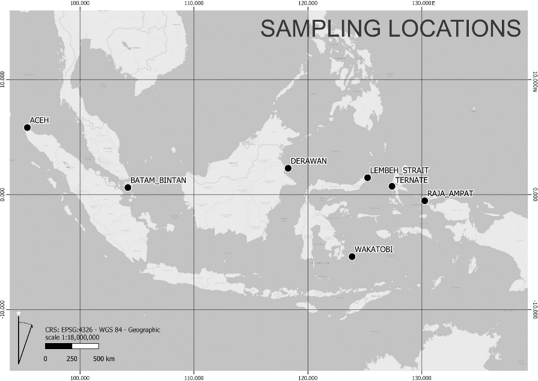
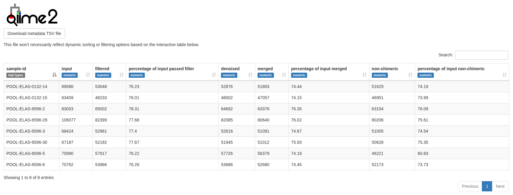
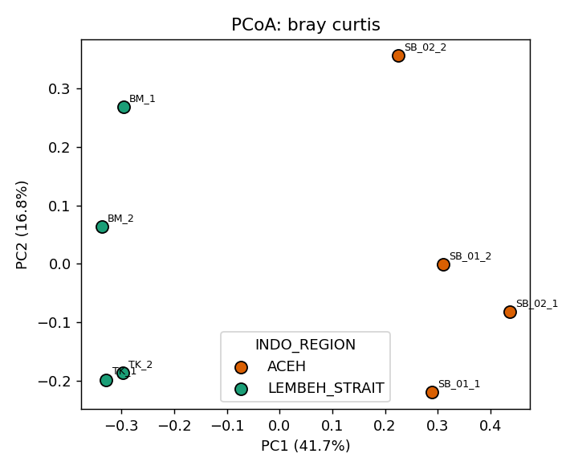
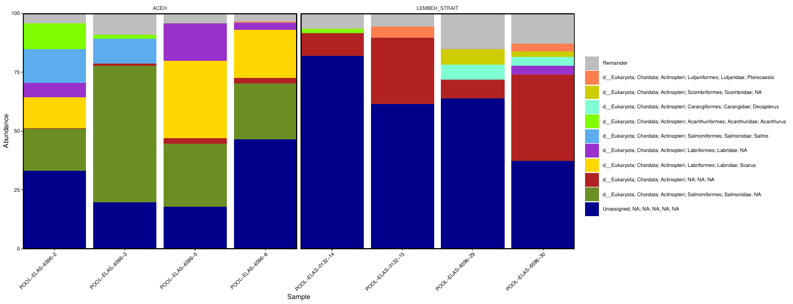
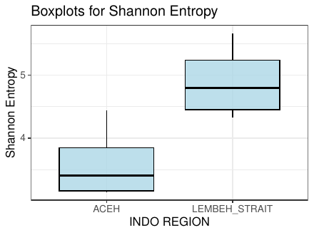

# Hands-On eDNA Metabarcoding for Tropical Biodiversity Assessment

A one-day practical workshop on fish eDNA metabarcoding with QIIME 2. Participants process paired-end MiFish 12S reads, assign taxonomy, and compare fish communities between two Indonesian reef regions.

Everything needed is in this repository: lecture slides (PDF), the manual (PDF), the teaching dataset, the reference database, install and run scripts, and example results with pictures of what each step should produce.

**Monash University Malaysia Genomics Platform (MUMGP)**

## What you will learn

- Import paired-end reads into QIIME 2 and inspect read quality
- Remove MiFish primers with Cutadapt
- Infer amplicon sequence variants (ASVs) with DADA2, and choose truncation settings
- Assign taxonomy against a fish 12S reference database (Mitohelper)
- Measure sequencing depth with rarefaction
- Compare alpha and beta diversity, with significance tests (Kruskal-Wallis, PERMANOVA)
- Test differential abundance with ANCOM-BC
- Make publication-style plots in R with qiime2R
- Understand how controls, sampling design and reference database coverage affect conclusions

## Quick start

Linux or Windows with WSL2, about 10 GB free disk space, internet connection.

**1. Get the repository**

```bash
git clone <this-repository-url> edna-metabarcoding-workshop
cd edna-metabarcoding-workshop
```

**2. Install the software** (creates the conda environments `edna-qiime2` and `edna-r`; add `--miniforge` if you do not have conda yet)

```bash
bash setup/install.sh
```

**3. Run the complete analysis in one go** (about 35 minutes with 8 threads; `-t` sets the number of CPU threads, results go to `./analysis`)

```bash
conda activate edna-qiime2
bash scripts/run_workflow.sh -t 8
```

**4. Make the R plots** (Module 07)

```bash
conda activate edna-r
cd analysis
cp ../scripts/Qiime2R-*.R .
Rscript Qiime2R-boxplotalpha.R
Rscript Qiime2R-taxabarplot.R
```

Open `.qzv` result files by dragging them into <https://view.qiime2.org/>.

To learn step by step instead, follow the modules below. Each command is copy-and-paste, and the picture after each command shows what you should see.

## Workshop dataset

Subset of the Indonesian coral-reef eDNA study by Marwayana et al. (2022), *Environmental DNA*. The original study sampled 39 sites across seven reef regions. Seawater DNA was amplified with MiFish primers (12S rRNA) and sequenced on Illumina MiSeq.

The teaching subset compares **Aceh** (western Indonesia) and **Lembeh Strait** (eastern Indonesia):

| Region | Site | Samples |
|---|---|---|
| Aceh | Benteng, Jaboi | 2 water replicates each |
| Lembeh Strait | Batu Merah, Teluk Kembahu | 2 water replicates each |

Total: 8 samples (16 FASTQ files). Question: *How do detected fish diversity and community composition differ between Aceh and Lembeh Strait?*



## Modules

Work through the modules in order, from the `analysis/` folder created in Module 00.

| # | Module | Topic | Slides |
|---|---|---|---|
| 00 | [Setup](modules/00_setup/) | Install software, prepare the data | [Workshop overview](slides/02_Workshop_Hands-On_Practical.pdf) |
| 01 | [Linux basics](modules/01_linux_basics/) | Command line essentials | [Introduction to Linux](slides/03_Introduction_to_Linux.pdf) |
| 02 | [Quality control, import and primer trimming](modules/02_import_and_qc/) | Check raw read quality, import reads, trim primers | [Lecture](slides/01_Lecture_eDNA_Metabarcoding.pdf) |
| 03 | [Denoising with DADA2](modules/03_denoising/) | ASVs, truncation length, with and without primer removal | [Lecture](slides/01_Lecture_eDNA_Metabarcoding.pdf) |
| 04 | [Diversity analysis](modules/04_diversity/) | Phylogeny, rarefaction, alpha and beta diversity, statistics | [Lecture](slides/01_Lecture_eDNA_Metabarcoding.pdf) |
| 05 | [Taxonomic classification](modules/05_taxonomy/) | Reference database, consensus BLAST, barplots | [Lecture](slides/01_Lecture_eDNA_Metabarcoding.pdf) |
| 06 | [Differential abundance](modules/06_differential_abundance/) | ANCOM-BC | [Lecture](slides/01_Lecture_eDNA_Metabarcoding.pdf) |
| 07 | [Plotting with qiime2R](modules/07_qiime2r_visualisation/) | Custom boxplots and taxa barplots in R | |

Also: [Workshop manual (PDF)](modules/eDNA_Workshop_Manual.pdf).

## All commands at a glance

The same commands as the modules, in order, for copy-and-paste. Run from the `analysis/` folder with `edna-qiime2` active. The modules show the expected output after each step.

<details>
<summary><b>Part A-B: import, quality control, primer trimming, DADA2</b> (<a href="modules/02_import_and_qc/">Module 02</a>, <a href="modules/03_denoising/">Module 03</a>)</summary>

```bash
mkdir fastqc_raw && fastqc -t 4 -o fastqc_raw raw_fastq/*.fastq.gz

qiime tools import --type 'SampleData[PairedEndSequencesWithQuality]' \
  --input-path raw_fastq --input-format CasavaOneEightSingleLanePerSampleDirFmt \
  --output-path paired-end-demux.qza
qiime demux summarize --i-data paired-end-demux.qza --o-visualization paired-end-demux.qzv

qiime cutadapt trim-paired --i-demultiplexed-sequences paired-end-demux.qza \
  --p-front-f GTCGGTAAAACTCGTGCCAGC --p-front-r CATAGTGGGGTATCTAATCCCAGTTTG \
  --p-error-rate 0.1 --p-overlap 12 --p-discard-untrimmed --p-cores 8 \
  --o-trimmed-sequences trimmed.qza
qiime demux summarize --i-data trimmed.qza --o-visualization trimmed.qzv

mkdir 01_denoising_clustering_summary
# DADA2 on the primer-trimmed reads, truncated at 180 bp (used in all later steps)
qiime dada2 denoise-paired --i-demultiplexed-seqs trimmed.qza \
  --p-trim-left-f 0 --p-trim-left-r 0 --p-trunc-len-f 180 --p-trunc-len-r 180 \
  --p-n-threads 8 --o-table table_180.qza \
  --o-representative-sequences rep-seqs_180.qza --o-denoising-stats denoising-stats_180.qza
qiime metadata tabulate --m-input-file denoising-stats_180.qza \
  --o-visualization 01_denoising_clustering_summary/denoising-stats_180.qzv
qiime feature-table summarize --i-table table_180.qza \
  --o-visualization 01_denoising_clustering_summary/table_180.qzv \
  --m-sample-metadata-file sample_metadata.txt
qiime feature-table tabulate-seqs --i-data rep-seqs_180.qza \
  --o-visualization 01_denoising_clustering_summary/rep-seqs_180.qzv
```

The two comparison runs (no truncation, and without primer removal) are in [Module 03](modules/03_denoising/).



</details>

<details>
<summary><b>Part C: diversity analysis</b> (<a href="modules/04_diversity/">Module 04</a>)</summary>

```bash
qiime phylogeny align-to-tree-mafft-fasttree --i-sequences rep-seqs_180.qza \
  --output-dir 02_phylogenetic_analysis

qiime diversity core-metrics-phylogenetic \
  --i-phylogeny 02_phylogenetic_analysis/rooted_tree.qza --i-table table_180.qza \
  --p-sampling-depth 45000 --m-metadata-file sample_metadata.txt \
  --output-dir 03_core-metrics-results

qiime diversity alpha-rarefaction --i-table table_180.qza \
  --i-phylogeny 02_phylogenetic_analysis/rooted_tree.qza --p-max-depth 45000 \
  --m-metadata-file sample_metadata.txt \
  --o-visualization 03_core-metrics-results/alpha-rarefaction_45000.qzv

for M in faith_pd evenness shannon observed_features; do
  qiime diversity alpha-group-significance \
    --i-alpha-diversity 03_core-metrics-results/${M}_vector.qza \
    --m-metadata-file sample_metadata.txt \
    --o-visualization 03_core-metrics-results/${M//_/-}-group-significance.qzv
done

for M in unweighted_unifrac weighted_unifrac bray_curtis jaccard; do
  qiime diversity beta-group-significance \
    --i-distance-matrix 03_core-metrics-results/${M}_distance_matrix.qza \
    --m-metadata-file sample_metadata.txt --m-metadata-column INDO_REGION --p-pairwise \
    --o-visualization 03_core-metrics-results/${M//_/-}-region-significance.qzv
done
```



</details>

<details>
<summary><b>Part D: taxonomic classification</b> (<a href="modules/05_taxonomy/">Module 05</a>)</summary>

```bash
mkdir 04_taxonomic_classification
qiime feature-classifier classify-consensus-blast --i-query rep-seqs_180.qza \
  --i-reference-reads 12S_database/12S-seqs-derep-uniq.qza \
  --i-reference-taxonomy 12S_database/12S-tax-derep-uniq.qza \
  --p-perc-identity 0.97 --p-query-cov 0.95 --p-maxaccepts 100 --p-min-consensus 0.8 \
  --o-classification 04_taxonomic_classification/taxonomy.qza \
  --o-search-results 04_taxonomic_classification/taxonomy-search-results.qza

qiime metadata tabulate --m-input-file 04_taxonomic_classification/taxonomy.qza \
  --o-visualization 04_taxonomic_classification/taxonomy.qzv
qiime taxa barplot --i-table table_180.qza --i-taxonomy 04_taxonomic_classification/taxonomy.qza \
  --m-sample-metadata-file sample_metadata.txt \
  --o-visualization 04_taxonomic_classification/taxa-bar-plots.qzv
```



</details>

<details>
<summary><b>Part E: differential abundance</b> (<a href="modules/06_differential_abundance/">Module 06</a>)</summary>

```bash
mkdir 05_ancom_result
qiime taxa collapse --i-table table_180.qza --i-taxonomy 04_taxonomic_classification/taxonomy.qza \
  --p-level 6 --o-collapsed-table 05_ancom_result/collapsed-taxonomy-table-level6.qza
qiime composition ancombc --i-table 05_ancom_result/collapsed-taxonomy-table-level6.qza \
  --m-metadata-file sample_metadata.txt --p-formula "INDO_REGION" \
  --o-differentials 05_ancom_result/differential.qza
qiime composition tabulate --i-data 05_ancom_result/differential.qza \
  --o-visualization 05_ancom_result/ancombc-region-table.qzv
qiime composition da-barplot --i-data 05_ancom_result/differential.qza \
  --p-significance-threshold 0.05 --o-visualization 05_ancom_result/ancombc-region-barplot.qzv
```

</details>

<details>
<summary><b>Part F: plots in R with qiime2R</b> (<a href="modules/07_qiime2r_visualisation/">Module 07</a>)</summary>

```bash
conda activate edna-r
cp ../scripts/Qiime2R-*.R .
Rscript Qiime2R-boxplotalpha.R
Rscript Qiime2R-taxabarplot.R
```



</details>

## Repository layout

```
edna-metabarcoding-workshop/
├── setup/
│   └── install.sh                  Install QIIME 2 + FastQC (edna-qiime2) and R + qiime2R (edna-r)
├── scripts/
│   ├── run_workflow.sh             Run the whole workflow (Modules 02-06) with one command
│   ├── Qiime2R-boxplotalpha.R      Alpha diversity boxplots (Module 07)
│   ├── Qiime2R-taxabarplot.R       Taxonomy barplots (Module 07)
│   ├── plot_pcoa.py                Static PCoA plot from QIIME 2 results
│   └── render_qzv_screenshots.py   Make PNG screenshots of .qzv files (used to build the docs)
├── modules/                        Step-by-step manual, one folder per module
│   ├── 00_setup/ ... 07_qiime2r_visualisation/
│   └── eDNA_Workshop_Manual.pdf    The workshop manual
├── slides/                         Lecture slides (PDF)
├── manual/images/                  Figures used in the manual and modules
├── data/
│   ├── raw_fastq/                  16 paired-end FASTQ files (8 samples)
│   ├── sample_metadata.txt         Sample table (region, site, replicate)
│   └── 12S_database/               Mitohelper 12S reference sequences and taxonomy (QIIME 2 artifacts)
├── example_results/                Reference outputs from a full run, same folder names as the modules
└── docs/images/                    Pictures shown in the modules
```

`example_results/` is there so you can compare your outputs. The two largest intermediate files (`paired-end-demux.qza` and `trimmed.qza`, 180-230 MB each) exceed GitHub's file size limit and are not included. You regenerate them in Modules 02 and 03.

## Software

| Tool | Version |
|---|---|
| QIIME 2 amplicon distribution | 2024.10 (installed by `setup/install.sh`; set `QIIME_VERSION` to change) |
| Cutadapt, DADA2, MAFFT, FastTree, ANCOM-BC | bundled with QIIME 2 |
| FastQC | latest from bioconda |
| R with qiime2R, dplyr, tibble, purrr, ggplot2 | installed in `edna-r` |

The files in `example_results/` were produced with QIIME 2 2026.1.0. Small numerical differences (for example PERMANOVA p-values, which use random permutations) are expected when you run it yourself.

## References

- Marwayana ON, et al. (2022). *Environmental DNA*.
- Lim & Thompson (2021). Mitohelper: A mitochondrial reference sequence analysis tool for fish eDNA studies.
- Miya M, et al. (2015). MiFish, a set of universal PCR primers for metabarcoding environmental DNA from fishes. *Royal Society Open Science*.
- Bolyen E, et al. (2019). Reproducible, interactive, scalable and extensible microbiome data science using QIIME 2. *Nature Biotechnology*.
- Callahan BJ, et al. (2016). DADA2: high-resolution sample inference from Illumina amplicon data. *Nature Methods*.
- Lin H, Peddada SD (2020). Analysis of compositions of microbiomes with bias correction. *Nature Communications*.

## Instructors

- Professor Qasim Ayub
- Dr. Gavin Wee Wei Yee
- Dr. Aswini Leela
- Dr. Cheah Hong Leong

## Acknowledgements

The Linux introduction in [Module 01](modules/01_linux_basics/) is adapted from the Wellcome Connecting Science FutureLearn course *Bioinformatics for Biologists: An Introduction to Linux, Bash Scripting, and R* (see the source note in that module).

Repository created and maintained by Dr. Aswini Leela ([@aswinileela](https://github.com/aswinileela)).
