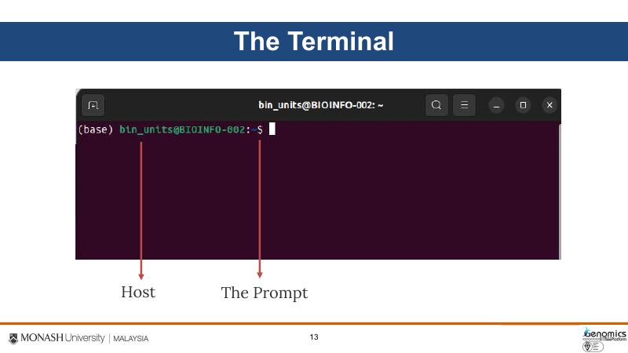

# Module 01: Linux basics

Slides: [Introduction to Linux](../../slides/03_Introduction_to_Linux.pdf)

## What is Linux? Why use Linux?

Linux is an operating system, like Microsoft Windows or Mac OSX (and lately Mac OS 11). An operating system (OS) is a computer program which manages how you connect to various pieces of hardware (screen, keyboard, mouse etc.) and also manages your files and allows you to run software applications. An OS will generally come with a graphical user interface (GUI) through which a user interacts with it. Each GUI looks a little different. It is worth noting that some of the terminology used varies from OS to OS so, for example, a folder in MS Windows is equivalent to a directory in Linux.

We will begin with a little history. The term Linux actually refers to a family of open source, Unix-like operating systems based on the Linux kernel, which was developed by Linus Torvalds, and first released in 1991. Unix itself refers to a family of multitasking, multi-user operating systems all derived from the original AT&T Unix, which was developed in the late 1970s. In practice, although Unix strictly refers to a commercial OS and Linux refers to a freely available, open source OS, the two words tend to be used interchangeably.

Linux now has many variants, all based around the same original kernel. Some are developed for specific purposes (e.g. a very minimal distribution which uses little disk space), others have more general, wide ranging purposes. Some of the more widely used versions of Linux include Ubuntu, CentOS, Redhat Enterprise Linux, Debian and Linux Mint. Whilst they vary in terms of GUI and some aspects of their core software (e.g. the method of installing software applications), they have the same core commands in common.

Linux is powerful, stable and robust and, with sufficient resources, allows dozens of users to run programs simultaneously on the same computer. This ability to scale upwards makes it the preferred operating system for large scale scientific computation. Linux is an operating system that can be used in everything from Android phones to desktop PCs through to super computers. Around the home, items such as smart TVs and newer, smart washing machines use Linux.

### Why use Linux?

But, why is Linux key to biology and bioinformatics? Increasingly, the output of lab-based biology exists as large text files, for example the data files from sequencing machines. Linux has a range of powerful and flexible commands which can be used to edit and manipulate these files. Importantly, these commands can be combined to effectively produce new commands. Whilst any Linux OS contains hundreds of commands, a user will generally find that they perform most basic analyses using, maybe, a dozen of them. In addition to the OS commands, the fact that Linux is freely available and incredibly flexible has meant that a large community of bioinformaticians and computer programmers has developed using it as their main OS and developing software primarily for use with Linux.

> **Note:** for the purpose of this course only, we use Linux and Unix interchangeably.

## The terminal and the command line

For the bioinformatician, the things which make Linux most powerful are the terminal and, within it, the command line.

Most Linux distributions come with an array of graphical user interface (GUI) based software included in them. There will generally be at least one web browser, a word processor, spreadsheet software and software for delivering presentations amongst them. In addition, in the field of bioinformatics, there are many graphically based programs available for Linux, which can be used for both data analysis and visualisation. However, for the bioinformatician, the things which make Linux most powerful are the terminal and, within it, the command line.

The Linux terminal is simply software which allows a user to interface with the computer by typing in text-based commands. The Mac OS has a terminal which is the direct equivalent of the one found in Linux. Older Windows versions had the MS-DOS prompt. Windows 10 now has the Windows Terminal, in addition to similar text-based interfaces such as PowerShell and Command Prompt.

The command line is the current line within the terminal which can be used to input text commands. Each command is run through a shell, a program which sends commands to the computer for it to interpret. Common shells include bash, zsh, tcsh/csh and ksh. In this course, we will focus on the bash shell. The basic commands tend to be the same across all shells but some of the more advanced commands may vary in syntax a little between them.

The command line allows users to run a vast range of commands and includes facilities to run successive commands as one single operation, with the output of one command fed directly into the next. It is also the starting point for running most bioinformatics software.

## Source

The text in this module is adapted from the Wellcome Connecting Science course *Bioinformatics for Biologists: An Introduction to Linux, Bash Scripting, and R* on FutureLearn (Wellcome Genome Campus Advanced Courses and Scientific Conferences):

- <https://futurelearn.com/info/courses/linux-for-bioinformatics/0/steps/194524>
- <https://futurelearn.com/info/courses/linux-for-bioinformatics/0/steps/194525>

Next: [Module 02: Quality control, import and primer trimming](../02_import_and_qc/)
