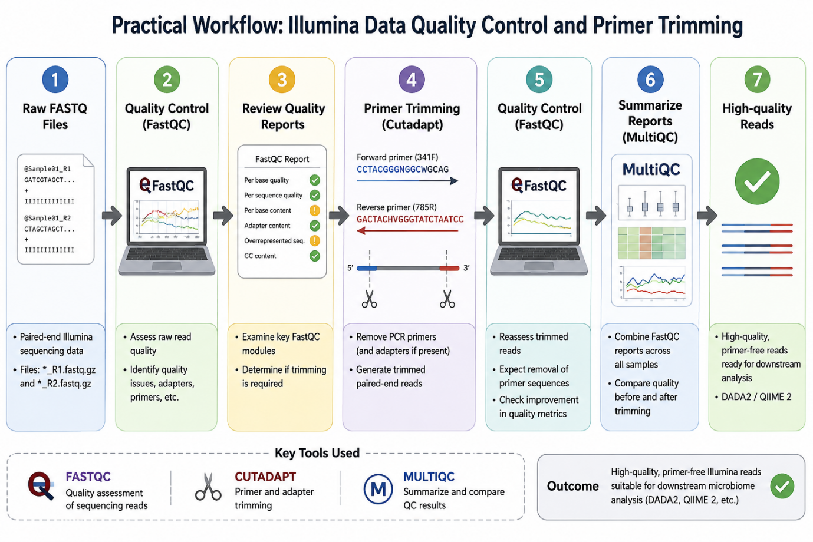
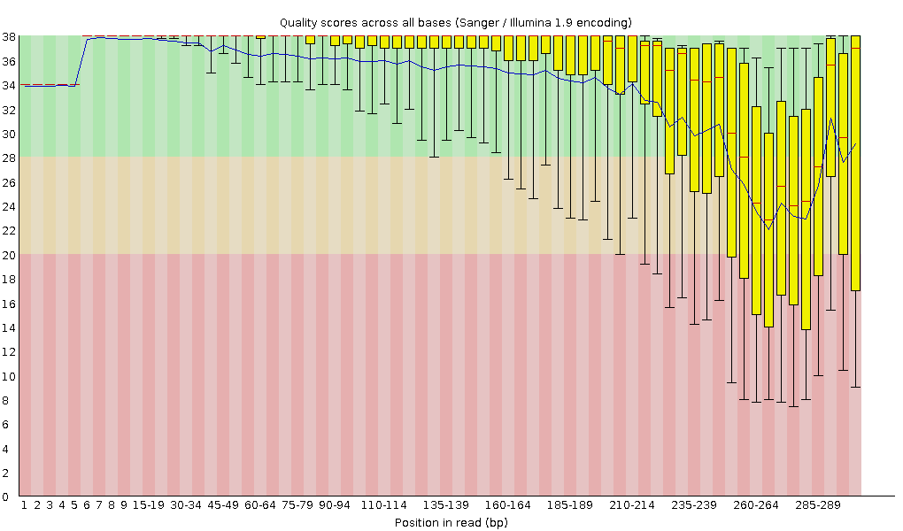
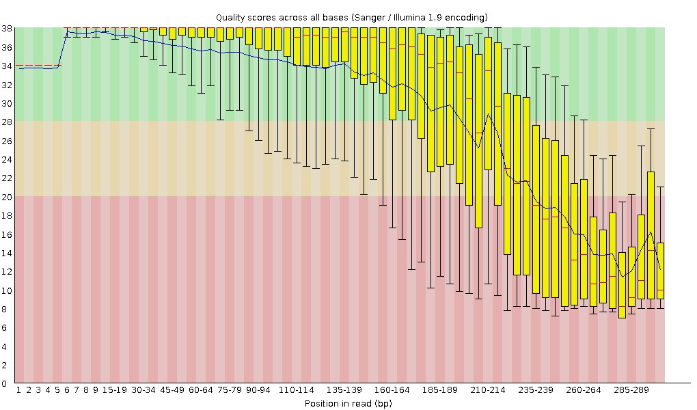
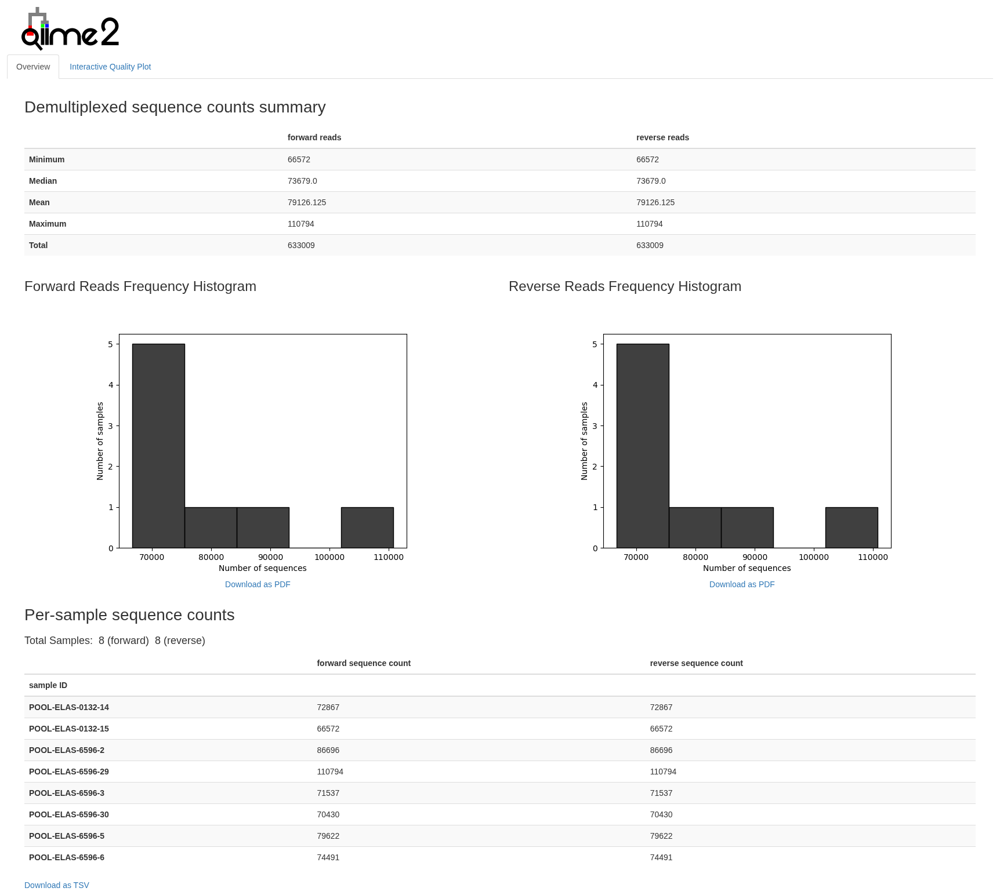
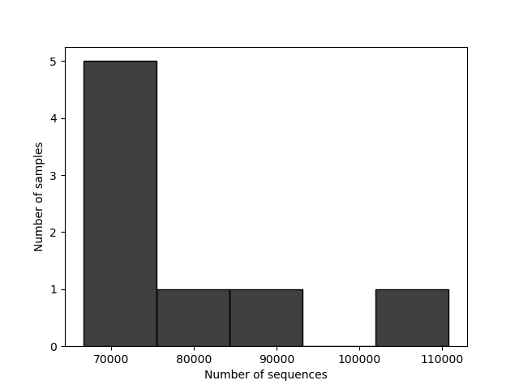

# Module 02: Quality control, import and primer trimming

Slides: [Lecture](../../slides/01_Lecture_eDNA_Metabarcoding.pdf) | Manual: [PDF](../eDNA_Workshop_Manual.pdf)

Run from the `analysis/` folder with `conda activate edna-qiime2` ([Module 00](../00_setup/)).

## The workflow

Raw reads contain unwanted sequence: PCR primers, Illumina adapters, low-quality bases, ambiguous bases (N) and sequencing artefacts. Leaving them in causes wrong taxonomic assignments, poorer denoising and inflated diversity. This module follows the workflow below: check the raw reads, trim the primers, then check again.



The figure is a generic illustration: the primers drawn in step 4 (341F/785R) are 16S examples. This workshop amplifies fish 12S rRNA with the **MiFish-U** primers (step 3 below). MultiQC (step 6 in the figure) is optional and not used here.

QIIME 2 is an open-source platform for reproducible amplicon analysis. Instead of clustering reads into OTUs, modern workflows infer **amplicon sequence variants (ASVs)**: exact sequences recovered after sequencing errors are corrected. DADA2 (Module 03) is a widely used denoising method that models Illumina error profiles to separate real sequences from errors.

## 1. Check the quality of the raw reads (FastQC)

FastQC reads the FASTQ files directly, so this comes before importing into QIIME 2.

```bash
mkdir fastqc_raw
fastqc -t 4 -o fastqc_raw raw_fastq/*.fastq.gz
```

Open the `.html` reports in `fastqc_raw/` with a web browser. Focus on **per-base quality**, **per-sequence quality** and **adapter content**. Warnings for per-base sequence content, overrepresented sequences and duplication levels are expected for 12S amplicons, because every read comes from the same PCR target.

**Expected per-base quality** (sample POOL-ELAS-6596-2, R1 then R2): good quality at the start, falling at the 3' end.




## 2. Import the reads into QIIME 2

Converts paired-end FASTQ files to a QIIME 2 artifact (`.qza`). `raw_fastq` is the folder holding the reads.

```bash
qiime tools import \
  --type 'SampleData[PairedEndSequencesWithQuality]' \
  --input-path raw_fastq \
  --input-format CasavaOneEightSingleLanePerSampleDirFmt \
  --output-path paired-end-demux.qza
```

Expected: `Imported raw_fastq as CasavaOneEightSingleLanePerSampleDirFmt to paired-end-demux.qza`

```bash
qiime demux summarize \
  --i-data paired-end-demux.qza \
  --o-visualization paired-end-demux.qzv
```

Open `paired-end-demux.qzv` at <https://view.qiime2.org/> (drag and drop the file). **Expected:** 8 samples, about 633,000 reads in total, median about 74,000 reads per sample.



The **Interactive Quality Plot** tab shows quality along the read. Forward reads (first) and reverse reads (second) lose quality toward the 3' end:




## 3. Trim primers with Cutadapt

Cutadapt removes primers, adapters and other unwanted sequence. Primers are artificial and must be removed before denoising: leftover primers shorten the read overlap used for merging, reduce ASV accuracy and bias classification.

MiFish-U primers (teleost 12S rRNA):

| Primer | Sequence (5' to 3') |
|---|---|
| MiFish-U-F | `GTCGGTAAAACTCGTGCCAGC` |
| MiFish-U-R | `CATAGTGGGGTATCTAATCCCAGTTTG` |

```bash
qiime cutadapt trim-paired \
  --i-demultiplexed-sequences paired-end-demux.qza \
  --p-front-f GTCGGTAAAACTCGTGCCAGC \
  --p-front-r CATAGTGGGGTATCTAATCCCAGTTTG \
  --p-error-rate 0.1 \
  --p-overlap 12 \
  --p-discard-untrimmed \
  --p-cores 8 \
  --o-trimmed-sequences trimmed.qza
```

Set `--p-cores` to the CPU cores you have. `--p-discard-untrimmed` drops read pairs where no primer was found. Expected: `Saved SampleData[PairedEndSequencesWithQuality] to: trimmed.qza`

## 4. Check the trimmed reads

```bash
qiime demux summarize \
  --i-data trimmed.qza \
  --o-visualization trimmed.qzv
```

**Expected:** about 604,000 read pairs remain (about 95% of the input), and the primer sequences are gone from the start of the reads.


## Questions

1. Compare `paired-end-demux.qzv` and `trimmed.qzv`. How do read length and read count change?
2. Why are FastQC sequence-content warnings expected here?

Next: [Module 03: Denoising with DADA2](../03_denoising/)
