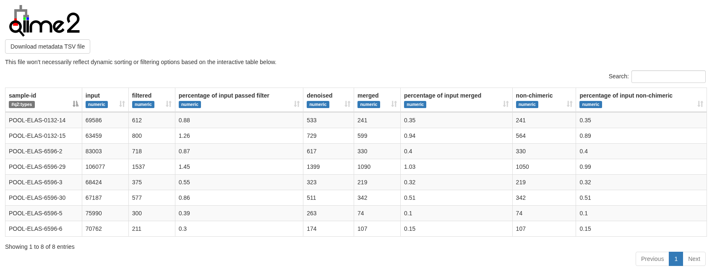
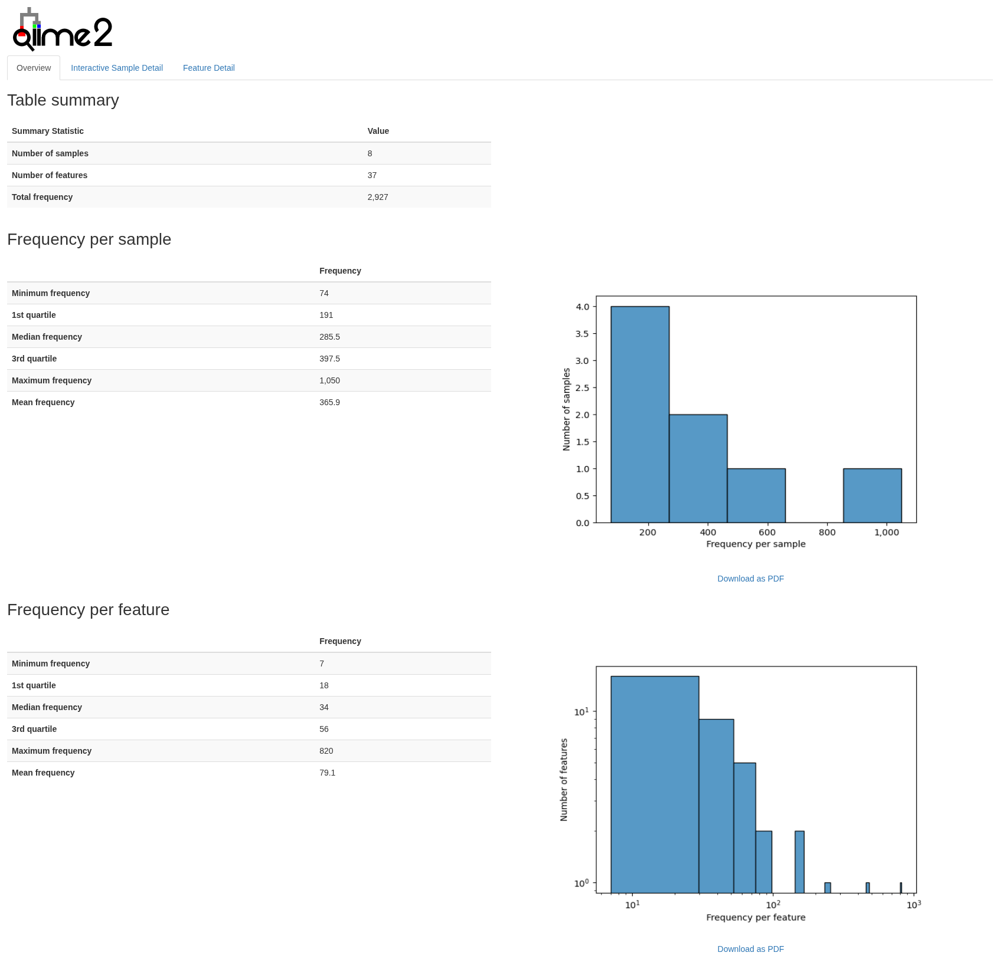
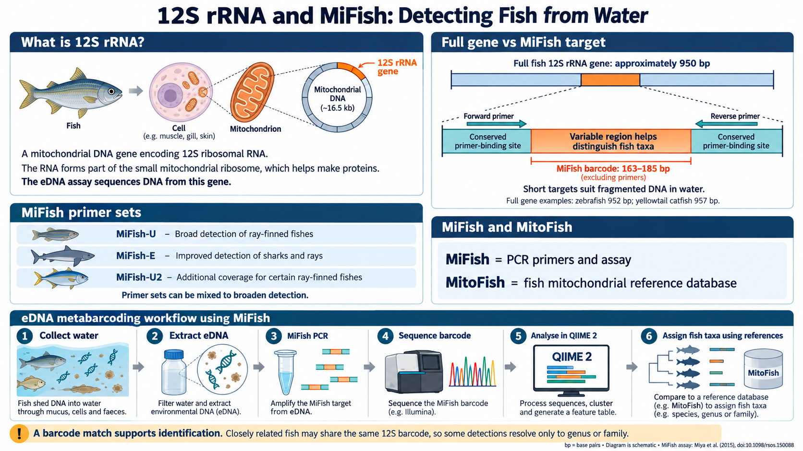
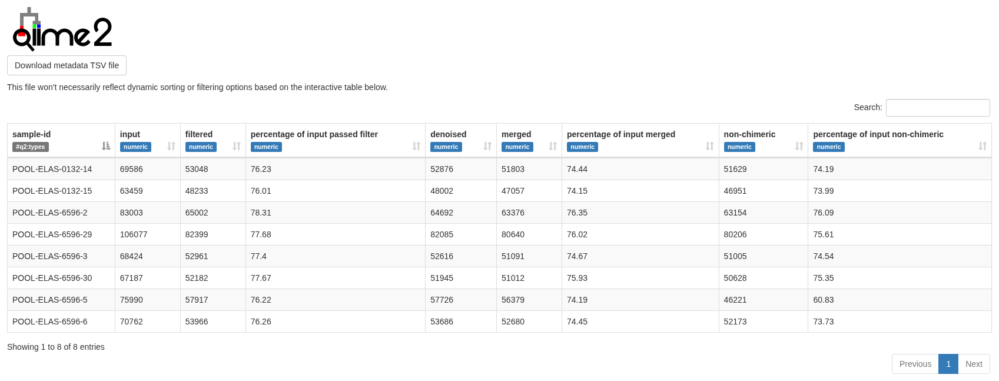
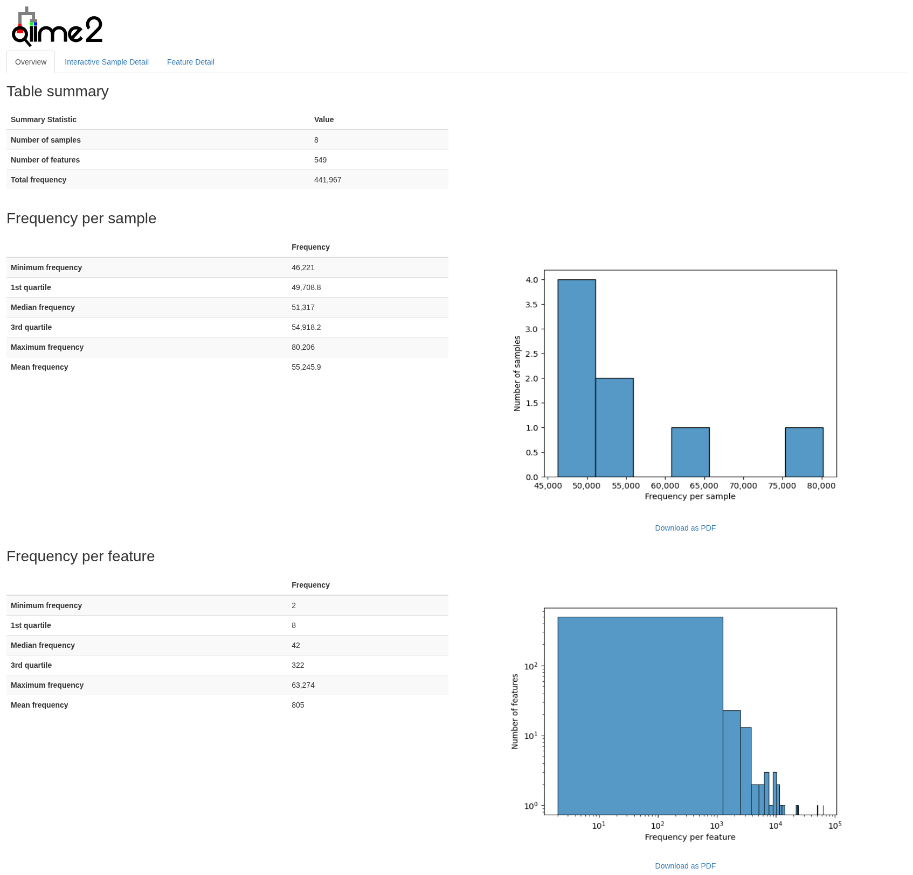
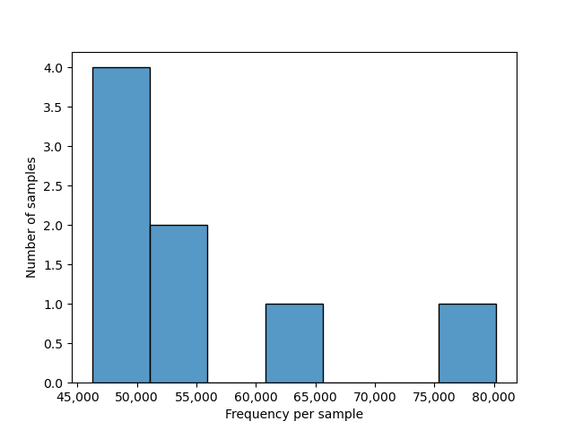
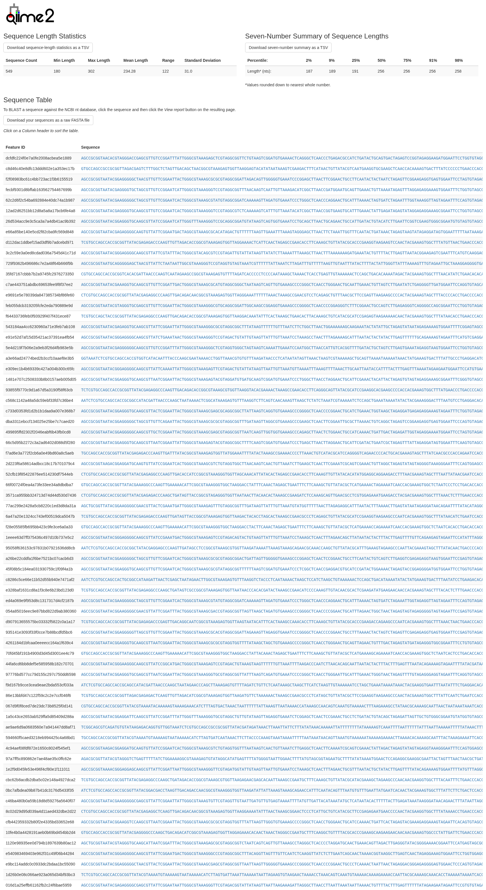

# Module 03: Denoising with DADA2

Slides: [Lecture](../../slides/01_Lecture_eDNA_Metabarcoding.pdf) | Manual: [PDF](../eDNA_Workshop_Manual.pdf)

DADA2 filters reads, learns the error model, merges read pairs, removes chimeras and outputs an ASV table. We run it three ways to see what primer removal and truncation do.

```bash
mkdir 01_denoising_clustering_summary
```

## 1. Denoise primer-trimmed reads (no truncation)

```bash
qiime dada2 denoise-paired \
  --i-demultiplexed-seqs trimmed.qza \
  --p-trim-left-f 0 --p-trim-left-r 0 \
  --p-trunc-len-f 0 --p-trunc-len-r 0 \
  --p-n-threads 8 \
  --o-table table.qza \
  --o-representative-sequences rep-seqs.qza \
  --o-denoising-stats denoising-stats.qza
```

DADA2 takes a few minutes. Convert the outputs to visualizations and view them at <https://view.qiime2.org/>:

```bash
qiime metadata tabulate \
  --m-input-file denoising-stats.qza \
  --o-visualization 01_denoising_clustering_summary/denoising-stats.qzv

qiime feature-table summarize \
  --i-table table.qza \
  --o-visualization 01_denoising_clustering_summary/table.qzv \
  --m-sample-metadata-file sample_metadata.txt

qiime feature-table tabulate-seqs \
  --i-data rep-seqs.qza \
  --o-visualization 01_denoising_clustering_summary/rep-seqs.qzv
```

**Expected:** almost every read is lost, only about 0.1-1% of input reads survive (2,927 reads in total) and only 37 ASVs remain. This is a poor result.




## 2. For comparison: without primer removal

Run DADA2 on the untrimmed reads to see what happens if primers stay in.

```bash
qiime dada2 denoise-paired \
  --i-demultiplexed-seqs paired-end-demux.qza \
  --p-trim-left-f 0 --p-trim-left-r 0 \
  --p-trunc-len-f 0 --p-trunc-len-r 0 \
  --p-n-threads 8 \
  --o-table table_ori.qza \
  --o-representative-sequences rep-seqs_ori.qza \
  --o-denoising-stats denoising-stats_ori.qza

qiime metadata tabulate \
  --m-input-file denoising-stats_ori.qza \
  --o-visualization 01_denoising_clustering_summary/denoising-stats_ori.qzv

qiime feature-table summarize \
  --i-table table_ori.qza \
  --o-visualization 01_denoising_clustering_summary/table_ori.qzv \
  --m-sample-metadata-file sample_metadata.txt

qiime feature-table tabulate-seqs \
  --i-data rep-seqs_ori.qza \
  --o-visualization 01_denoising_clustering_summary/rep-seqs_ori.qzv
```

**Expected:** even worse: 0.0-0.6% of reads survive (1,290 reads in total) and 24 ASVs.


## 3. Truncate the low-quality read ends

The MiFish barcode is about 163-185 bp long excluding primers, a short part of the 12S gene. Forward and reverse reads cover it from opposite ends, so enough good-quality bases must remain in both reads to overlap and merge. Cutting both reads at 180 bp removes the low-quality 3' tails (see [Module 02](../02_import_and_qc/)).



**The table and sequences from this step (`table_180.qza`, `rep-seqs_180.qza`) are used in all later modules.**

```bash
qiime dada2 denoise-paired \
  --i-demultiplexed-seqs trimmed.qza \
  --p-trim-left-f 0 --p-trim-left-r 0 \
  --p-trunc-len-f 180 --p-trunc-len-r 180 \
  --p-n-threads 8 \
  --o-table table_180.qza \
  --o-representative-sequences rep-seqs_180.qza \
  --o-denoising-stats denoising-stats_180.qza

qiime metadata tabulate \
  --m-input-file denoising-stats_180.qza \
  --o-visualization 01_denoising_clustering_summary/denoising-stats_180.qzv

qiime feature-table summarize \
  --i-table table_180.qza \
  --o-visualization 01_denoising_clustering_summary/table_180.qzv \
  --m-sample-metadata-file sample_metadata.txt

qiime feature-table tabulate-seqs \
  --i-data rep-seqs_180.qza \
  --o-visualization 01_denoising_clustering_summary/rep-seqs_180.qzv
```

**Expected:** 61-76% of input reads survive (441,967 reads in total), and 549 ASVs are found. Every sample has more than 46,000 reads.





`rep-seqs_180.qzv` lists the ASV sequences:



Reference files: [`example_results/01_denoising_clustering_summary/`](../../example_results/01_denoising_clustering_summary/)

## Questions

1. In the three `denoising-stats` tables, how many reads survive filtering, merging and chimera removal?
2. How do the number of ASVs and the per-sample read counts differ between the three runs?
3. What goes wrong if the truncation length is too short for read pairs to overlap?

[](../04_diversity/) &nbsp; **[Module 04: Diversity analysis](../04_diversity/)**