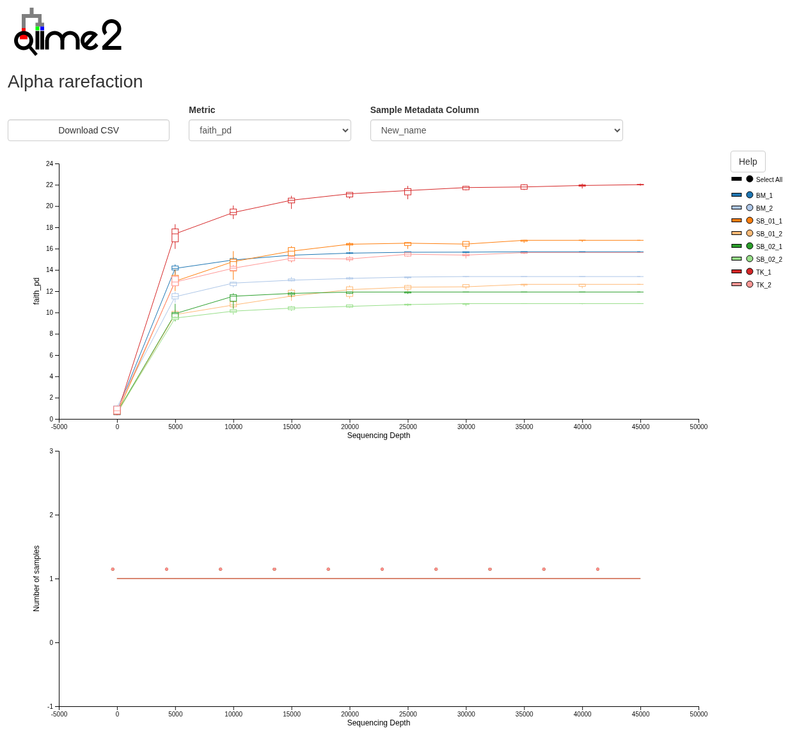
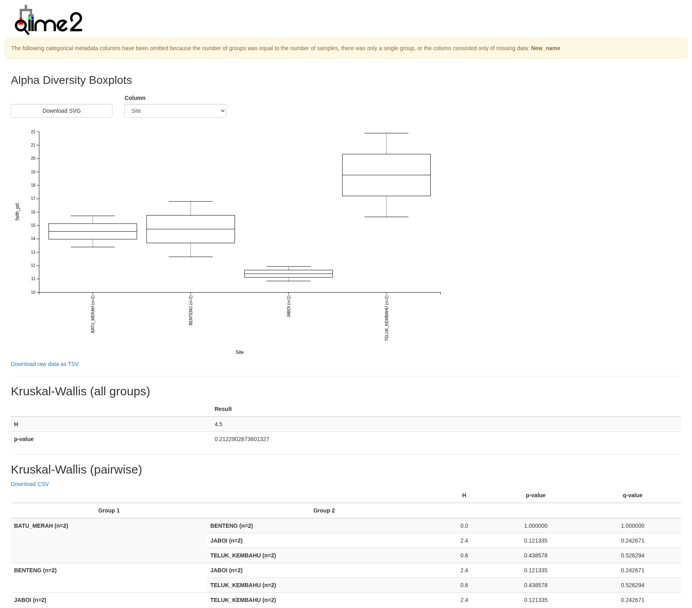
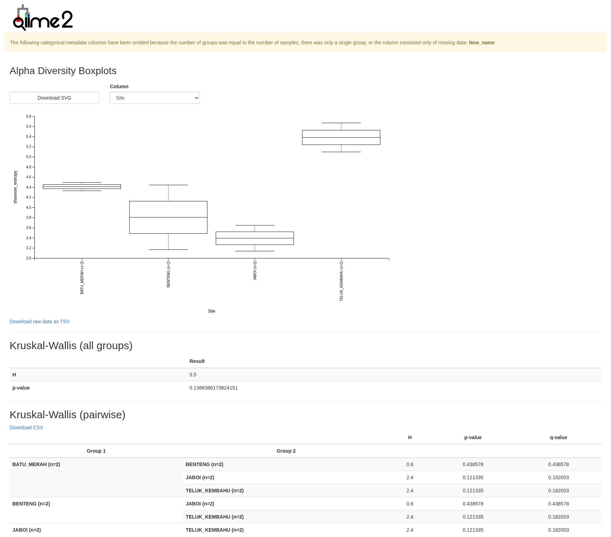
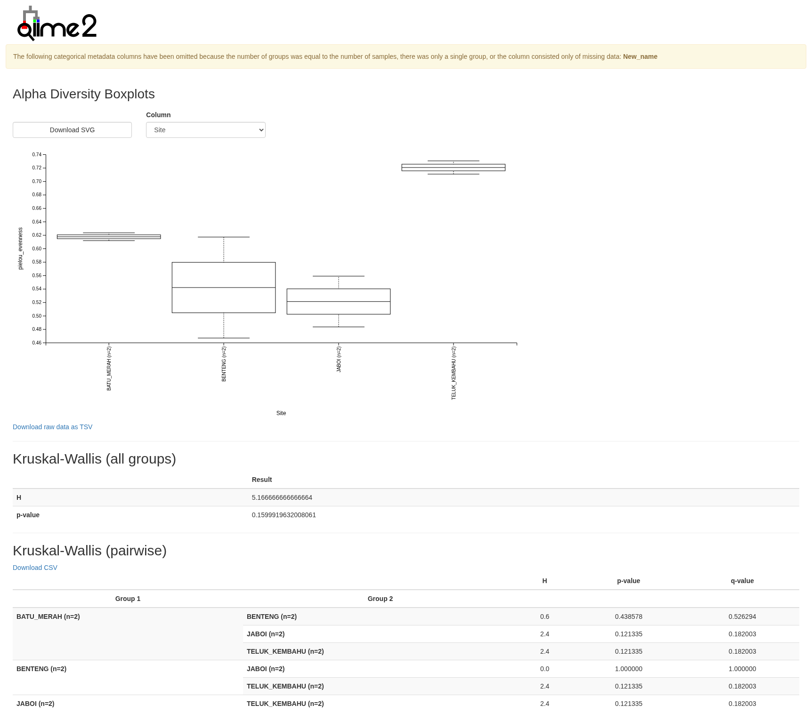
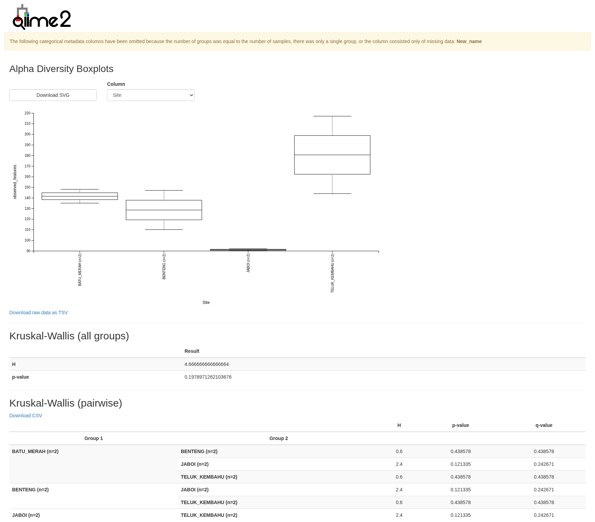
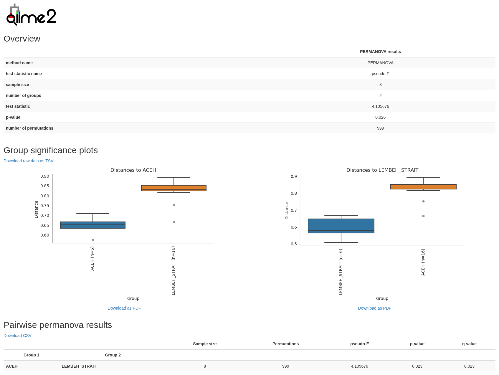
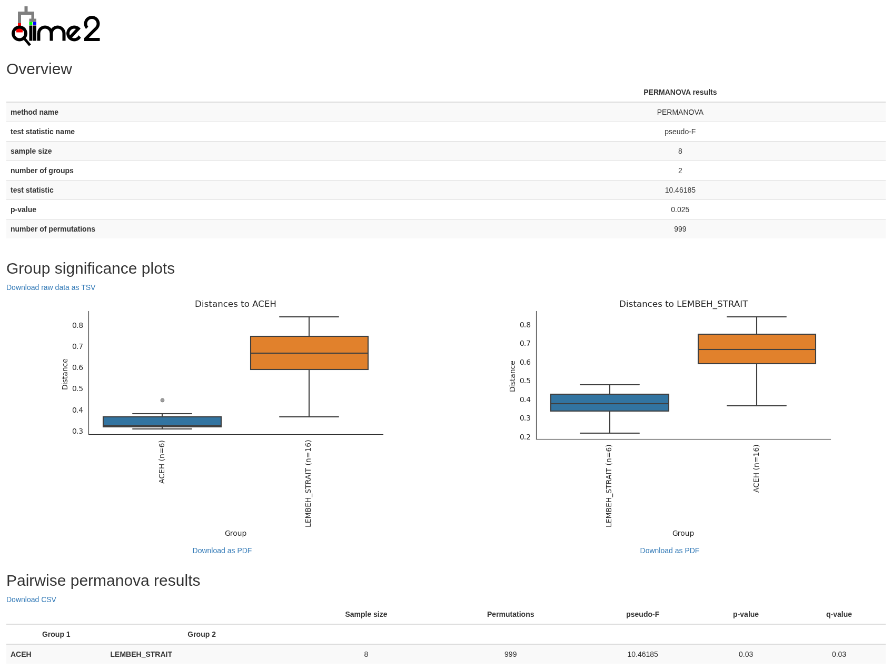
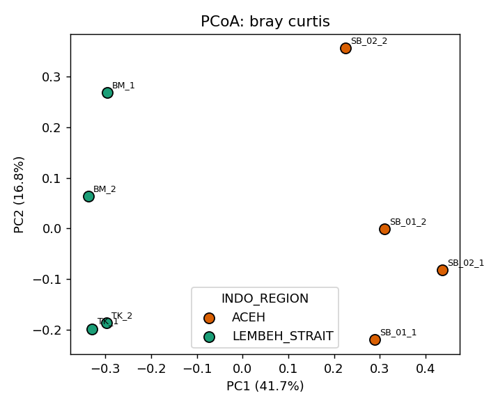

# Module 04: Diversity analysis

Slides: [Lecture](../../slides/01_Lecture_eDNA_Metabarcoding.pdf) | Manual: [PDF](../eDNA_Workshop_Manual.pdf)

Diversity analysis describes the variety and composition of fish communities within and between locations.

- **Alpha diversity**: diversity within one sample. It has two components: *richness* (how many taxa) and *evenness* (how evenly individuals are spread among taxa).
- **Beta diversity**: difference in composition between samples. It reflects turnover across environments.

| Alpha metric | What it measures |
|---|---|
| Observed features | Count of ASVs observed in a sample |
| Shannon entropy | Richness and evenness together |
| Pielou's evenness | Evenness, 0 to 1 (1 = all taxa equally abundant) |
| Faith's PD | Richness weighted by evolutionary relationships |

| Beta metric | What it measures |
|---|---|
| Bray-Curtis | Abundance-based dissimilarity, 0 (identical) to 1 (completely different) |
| Jaccard | Presence/absence; shared versus unique taxa |
| Unweighted / weighted UniFrac | Phylogenetic distance (presence/absence / abundance-weighted) |

Uses `table_180.qza` and `rep-seqs_180.qza` from [Module 03](../03_denoising/). Run from the `analysis/` folder.

## 1. Build a phylogenetic tree

Faith's PD and UniFrac need a tree of the ASVs.

```bash
qiime phylogeny align-to-tree-mafft-fasttree \
  --i-sequences rep-seqs_180.qza \
  --output-dir 02_phylogenetic_analysis
```

**Expected:** four files in `02_phylogenetic_analysis/`: `alignment.qza`, `masked_alignment.qza`, `tree.qza`, `rooted_tree.qza`.

## 2. Core diversity metrics and rarefaction

Samples are rarefied (randomly subsampled) to a common depth so they can be compared fairly. The smallest sample has 46,221 reads (see the table summary in Module 03), so a depth of **45,000** keeps all 8 samples.

```bash
qiime diversity core-metrics-phylogenetic \
  --i-phylogeny 02_phylogenetic_analysis/rooted_tree.qza \
  --i-table table_180.qza \
  --p-sampling-depth 45000 \
  --m-metadata-file sample_metadata.txt \
  --output-dir 03_core-metrics-results
```

`--output-dir` must not already exist. **Expected:** 20 files in `03_core-metrics-results/`: the rarefied table, four alpha vectors (`faith_pd`, `shannon`, `observed_features`, `evenness`), four distance matrices, four PCoA results and four Emperor plots.

An alpha-rarefaction curve checks whether 45,000 reads is enough to capture each sample's diversity:

```bash
qiime diversity alpha-rarefaction \
  --i-table table_180.qza \
  --i-phylogeny 02_phylogenetic_analysis/rooted_tree.qza \
  --p-max-depth 45000 \
  --m-metadata-file sample_metadata.txt \
  --o-visualization 03_core-metrics-results/alpha-rarefaction_45000.qzv
```

**Expected:** every curve climbs steeply and then flattens well before 45,000 reads, so sequencing depth is sufficient. Use the metric and metadata-column drop-downs to explore.



## 3. Alpha diversity significance (Kruskal-Wallis)

```bash
qiime diversity alpha-group-significance \
  --i-alpha-diversity 03_core-metrics-results/faith_pd_vector.qza \
  --m-metadata-file sample_metadata.txt \
  --o-visualization 03_core-metrics-results/faith-pd-group-significance.qzv

qiime diversity alpha-group-significance \
  --i-alpha-diversity 03_core-metrics-results/evenness_vector.qza \
  --m-metadata-file sample_metadata.txt \
  --o-visualization 03_core-metrics-results/evenness-group-significance.qzv

qiime diversity alpha-group-significance \
  --i-alpha-diversity 03_core-metrics-results/shannon_vector.qza \
  --m-metadata-file sample_metadata.txt \
  --o-visualization 03_core-metrics-results/shannon-group-significance.qzv

qiime diversity alpha-group-significance \
  --i-alpha-diversity 03_core-metrics-results/observed_features_vector.qza \
  --m-metadata-file sample_metadata.txt \
  --o-visualization 03_core-metrics-results/observed-features-group-significance.qzv
```

**Expected:** a boxplot per metadata column plus Kruskal-Wallis statistics. Use the **Column** drop-down and select `INDO_REGION` to compare Aceh with Lembeh Strait. A warning about columns omitted because every sample is its own group (for example `New_name`) is normal.

Faith's PD:



Shannon entropy:



Evenness:



Observed features:



## 4. Beta diversity significance (PERMANOVA)

Tests whether the two regions (`INDO_REGION`) differ in composition, for each distance matrix.

```bash
qiime diversity beta-group-significance \
  --i-distance-matrix 03_core-metrics-results/unweighted_unifrac_distance_matrix.qza \
  --m-metadata-file sample_metadata.txt \
  --m-metadata-column INDO_REGION \
  --p-pairwise \
  --o-visualization 03_core-metrics-results/unweighted-unifrac-region-significance.qzv

qiime diversity beta-group-significance \
  --i-distance-matrix 03_core-metrics-results/weighted_unifrac_distance_matrix.qza \
  --m-metadata-file sample_metadata.txt \
  --m-metadata-column INDO_REGION \
  --p-pairwise \
  --o-visualization 03_core-metrics-results/weighted-unifrac-region-significance.qzv

qiime diversity beta-group-significance \
  --i-distance-matrix 03_core-metrics-results/bray_curtis_distance_matrix.qza \
  --m-metadata-file sample_metadata.txt \
  --m-metadata-column INDO_REGION \
  --p-pairwise \
  --o-visualization 03_core-metrics-results/bray-curtis-region-significance.qzv

qiime diversity beta-group-significance \
  --i-distance-matrix 03_core-metrics-results/jaccard_distance_matrix.qza \
  --m-metadata-file sample_metadata.txt \
  --m-metadata-column INDO_REGION \
  --p-pairwise \
  --o-visualization 03_core-metrics-results/jaccard-region-significance.qzv
```

**Expected:** all four metrics give a significant difference between regions, with p about 0.02-0.04 (999 random permutations, so the p-value changes slightly between runs; the values below are from the example run):

| Metric | pseudo-F | p |
|---|---|---|
| Unweighted UniFrac | 2.10 | 0.028 |
| Weighted UniFrac | 10.46 | 0.025 |
| Bray-Curtis | 4.11 | 0.026 |
| Jaccard | 1.88 | 0.023 |

Bray-Curtis:



Weighted UniFrac:



## 5. Ordination (PCoA)

Open the `*_emperor.qzv` files in <https://view.qiime2.org/>, then under **Color** choose `INDO_REGION` or `Site`. Each dot is a sample; samples closer together have more similar communities. A static version of the same Bray-Curtis ordination (made with `scripts/plot_pcoa.py`) is below. Aceh and Lembeh Strait separate along PC1.



Optional, to draw static plots yourself (needs `pandas` and `matplotlib`, which come with the `edna-qiime2` environment):

```bash
python3 ../scripts/plot_pcoa.py 03_core-metrics-results/bray_curtis_pcoa_results.qza \
  sample_metadata.txt INDO_REGION bray_curtis_pcoa.png "PCoA: Bray-Curtis"
```

Reference files: [`example_results/03_core-metrics-results/`](../../example_results/03_core-metrics-results/)

## Questions

1. Does the rarefaction curve plateau? What would a much lower depth change?
2. Which alpha metrics are higher in Lembeh Strait? With only 4 samples per region, how much weight would you put on the p-values?
3. Do the PCoA plots separate by region, by site, or both? Do the replicates of a site cluster together?

Next: [Module 05: Taxonomic classification](../05_taxonomy/)
