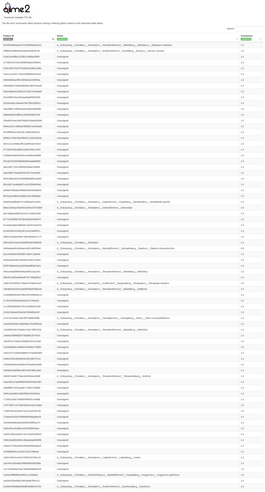
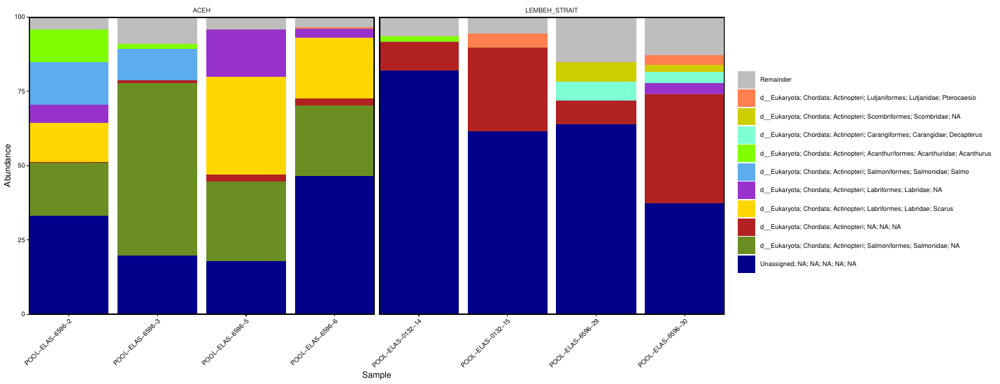

# Module 05: Taxonomic classification

Slides: [Lecture](../../slides/01_Lecture_eDNA_Metabarcoding.pdf) | Manual: [PDF](../eDNA_Workshop_Manual.pdf)

Each ASV is compared with labelled reference sequences to find which fish taxon it belongs to. Methods include alignment-based search (BLAST, VSEARCH) and a trained Naive Bayes classifier. This workshop uses consensus BLAST.

Accuracy depends on reference database coverage, correct reference labels, and whether the MiFish barcode can tell taxa apart. Some closely related species share identical 12S sequences, so report each assignment at the **lowest rank the evidence supports**, not always species.

Run from the `analysis/` folder with `table_180.qza` and `rep-seqs_180.qza` from [Module 03](../03_denoising/).

## Reference database

[Mitohelper](https://github.com/aomlomics/mitohelper) is a fish mitochondrial reference resource and Python tool. It builds on MitoFish and adds gene annotations and taxonomy from NCBI, plus fish classification from *Fishes of the World*. Reference: Lim & Thompson (2021).

Provided in [`data/12S_database/`](../../data/12S_database/) (copied to `analysis/12S_database/` in Module 00):

| File | Contents |
|---|---|
| `12S-seqs-derep-uniq.qza` | Dereplicated 12S reference sequences |
| `12S-tax-derep-uniq.qza` | Matching taxonomic labels |

41,988 annotated sequences. These artifacts were built with QIIME 2 2024.10.1, the version installed by `setup/install.sh`, so they can be used directly.

## 1. Classify the ASVs

```bash
mkdir 04_taxonomic_classification

qiime feature-classifier classify-consensus-blast \
  --i-query rep-seqs_180.qza \
  --i-reference-reads 12S_database/12S-seqs-derep-uniq.qza \
  --i-reference-taxonomy 12S_database/12S-tax-derep-uniq.qza \
  --p-perc-identity 0.97 \
  --p-query-cov 0.95 \
  --p-maxaccepts 100 \
  --p-min-consensus 0.8 \
  --o-classification 04_taxonomic_classification/taxonomy.qza \
  --o-search-results 04_taxonomic_classification/taxonomy-search-results.qza
```

| Parameter | Meaning |
|---|---|
| `--p-perc-identity 0.97` | Minimum percent identity of a hit |
| `--p-query-cov 0.95` | Minimum fraction of the ASV that must align |
| `--p-maxaccepts 100` | Max number of hits kept per ASV |
| `--p-min-consensus 0.8` | Fraction of hits that must agree for a rank to be assigned |

<details>
<summary>If you get a version error (newer QIIME 2 than 2024.10)</summary>

A `.qza` is a zip archive. Extract the raw data and import it again with your own QIIME 2, then repeat the command above using `reference-sequences.qza` and `reference-taxonomy.qza`:

```bash
unzip -p 12S_database/12S-seqs-derep-uniq.qza '*/data/dna-sequences.fasta' \
  > 12S_database/reference-sequences.fasta
unzip -p 12S_database/12S-tax-derep-uniq.qza '*/data/taxonomy.tsv' \
  > 12S_database/reference-taxonomy.tsv

qiime tools import \
  --type 'FeatureData[Sequence]' \
  --input-path 12S_database/reference-sequences.fasta \
  --input-format DNAFASTAFormat \
  --output-path reference-sequences.qza

qiime tools import \
  --type 'FeatureData[Taxonomy]' \
  --input-path 12S_database/reference-taxonomy.tsv \
  --input-format TSVTaxonomyFormat \
  --output-path reference-taxonomy.qza
```

</details>

## 2. Look at the assignments

```bash
qiime metadata tabulate \
  --m-input-file 04_taxonomic_classification/taxonomy.qza \
  --o-visualization 04_taxonomic_classification/taxonomy.qzv
```

**Expected:** a table of 549 ASVs with the assigned `Taxon` and a `Confidence` value. About 113 ASVs receive a taxonomic assignment (class, order, family, genus or species) and 436 (about 80%) are `Unassigned`: no reference sequence matched at 97% identity and 95% coverage. Assigned examples include *Scarus*, *Acanthurus*, *Caesio*, *Pterocaesio*, *Chlorurus*, *Pseudanthias*, *Zanclus cornutus* and *Balistapus undulatus*.



## 3. Taxonomy barplots

```bash
qiime taxa barplot \
  --i-table table_180.qza \
  --i-taxonomy 04_taxonomic_classification/taxonomy.qza \
  --m-metadata-file sample_metadata.txt \
  --o-visualization 04_taxonomic_classification/taxa-bar-plots.qzv
```

Open `taxa-bar-plots.qzv` at <https://view.qiime2.org/>. Use **Taxonomic Level** (level 6 is genus) and **Sort Samples By** (`INDO_REGION`) to compare samples. The opening view is level 1, which shows only `Eukaryota` and `Unassigned`.

The same data drawn in R in [Module 07](../07_qiime2r_visualisation/), by genus. Samples are grouped by region (Aceh left, Lembeh Strait right):



Reference files: [`example_results/04_taxonomic_classification/`](../../example_results/04_taxonomic_classification/)

## Questions

1. Which fish groups dominate each region?
2. About 80% of ASVs are unassigned. What does this say about reference coverage for Indonesian reef fish, and what could you do about it?
3. A salmonid (*Salmo salar*) is among the assignments. Is that plausible on a tropical reef? What could explain it (database labels, contamination, food-web or market DNA), and how would negative controls help?
4. Why should detections not be read as fish abundance or biomass?

Next: [Module 06: Differential abundance](../06_differential_abundance/)
