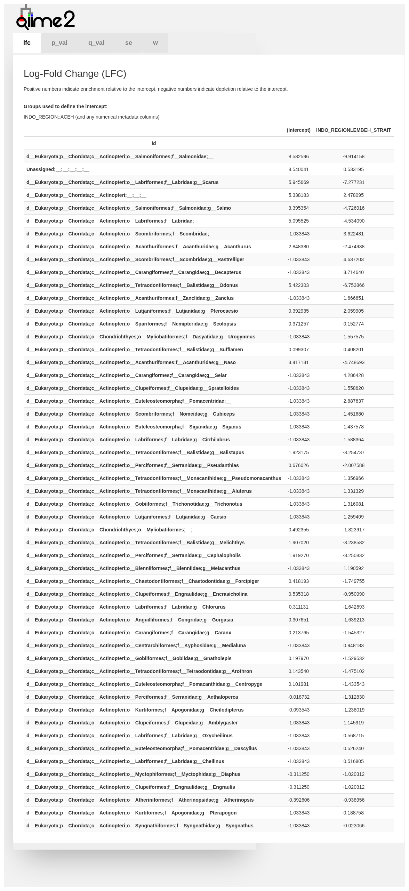

# Module 06: Differential abundance with ANCOM-BC

Slides: [Lecture](../../slides/01_Lecture_eDNA_Metabarcoding.pdf) | Manual: [PDF](../eDNA_Workshop_Manual.pdf)

Diversity analysis describes whole-community patterns. Differential abundance asks which individual taxa differ between groups, here Aceh versus Lembeh Strait.

**ANCOM-BC** (Analysis of Compositions of Microbiomes with Bias Correction) handles the fact that sequencing counts are *compositional*: a taxon's count depends partly on the other taxa and on total sequencing effort. It estimates and corrects differences in sampling fraction between samples, then tests between groups. Results:

- **Log-fold change (LFC)**: direction and size of the difference. With Aceh as the reference, a positive coefficient for Lembeh means higher estimated abundance in Lembeh; a negative one means higher in Aceh.
- **Adjusted p-value (q-value)**: corrected for testing many taxa.

Notes:

- Use the **unrarefied** count table.
- Water replicates from the same site are not independent sites. Account for this when interpreting results.
- Results reflect differences in detected DNA signal, not fish numbers or biomass.

Run from the `analysis/` folder, after [Module 05](../05_taxonomy/).

## 1. Collapse the table to genus level

Level 6 of the taxonomy string is genus.

```bash
mkdir 05_ancom_result

qiime taxa collapse \
  --i-table table_180.qza \
  --i-taxonomy 04_taxonomic_classification/taxonomy.qza \
  --p-level 6 \
  --o-collapsed-table 05_ancom_result/collapsed-taxonomy-table-level6.qza
```

**Expected:** a table of 53 features (genus-level labels, including some that are only partly resolved).

## 2. Run ANCOM-BC

```bash
qiime composition ancombc \
  --i-table 05_ancom_result/collapsed-taxonomy-table-level6.qza \
  --m-metadata-file sample_metadata.txt \
  --p-formula "INDO_REGION" \
  --o-differentials 05_ancom_result/differential.qza
```

## 3. View the results

```bash
qiime composition tabulate \
  --i-data 05_ancom_result/differential.qza \
  --o-visualization 05_ancom_result/ancombc-region-table.qzv

qiime composition da-barplot \
  --i-data 05_ancom_result/differential.qza \
  --p-significance-threshold 0.05 \
  --o-visualization 05_ancom_result/ancombc-region-barplot.qzv
```

**Expected:** `ancombc-region-table.qzv` has tabs for LFC, p-value, q-value, standard error and W. The column `INDO_REGION[LEMBEH_STRAIT]` holds the Lembeh-versus-Aceh effect. In the example data, **7 of 53 features have q < 0.05**. Three genera are higher in Aceh (*Scarus*, *Odonus*, *Naso*) and two are higher in Lembeh Strait (*Rastrelliger*, *Selar*); the other two significant features are only partly resolved taxa. Exact values can differ slightly between software versions.



`ancombc-region-barplot.qzv` opens to a page with one link per metadata column; click the `INDO_REGION` link to get the bar plot of significant taxa.

Reference files: [`example_results/05_ancom_result/`](../../example_results/05_ancom_result/)

## Questions

1. Which taxa are significantly different at q < 0.05, and in which direction?
2. With 2 sites per region, what could limit the conclusions?
3. How would you design sampling to separate region effects from site effects?

[](../07_qiime2r_visualisation/) &nbsp; **[Module 07: Plotting with qiime2R](../07_qiime2r_visualisation/)**