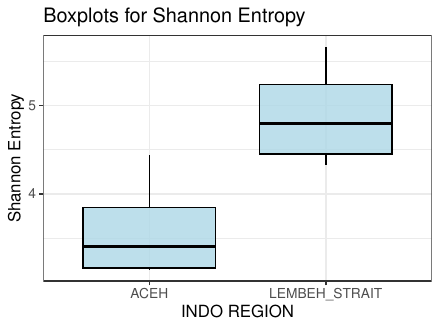
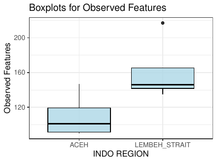
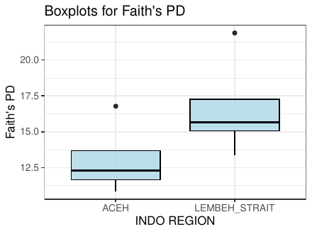
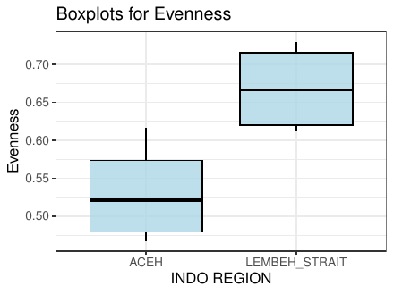
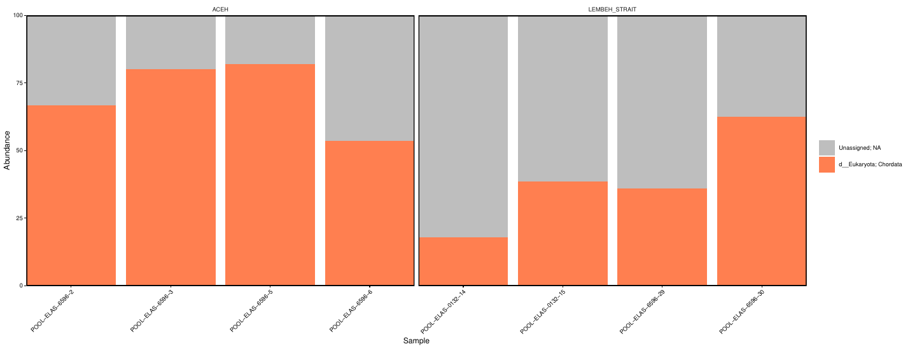
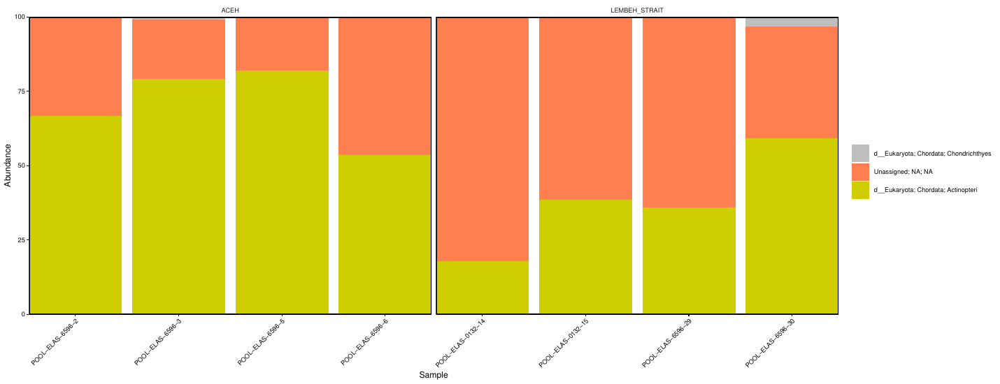
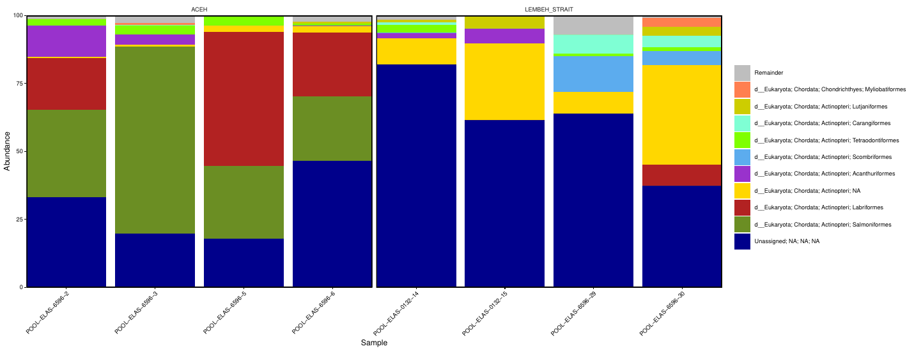
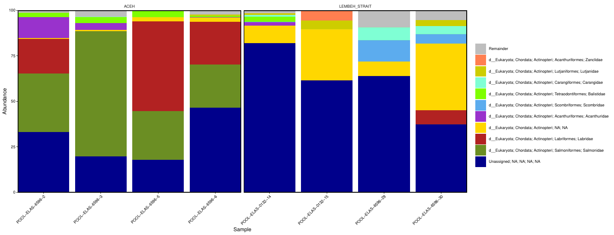
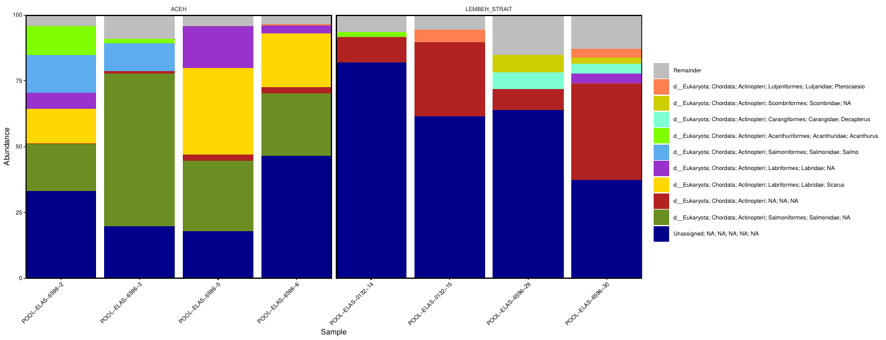
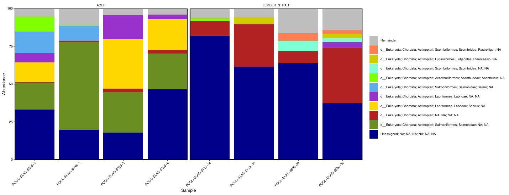

# Module 07: Plotting with qiime2R

Manual: [PDF](../eDNA_Workshop_Manual.pdf)

[qiime2R](https://github.com/jbisanz/qiime2R) imports QIIME 2 artifacts into R: count tables, taxonomy, metadata, diversity metrics and ordinations, and can build phyloseq objects. `read_qza()` reads an artifact and its `$data` element holds the underlying data.

This module makes two sets of custom figures:

| Script | Input | Output |
|---|---|---|
| [`Qiime2R-boxplotalpha.R`](../../scripts/Qiime2R-boxplotalpha.R) | `03_core-metrics-results/*_vector.qza`, `sample_metadata.txt` | Alpha diversity boxplots by `INDO_REGION` in `06_alpha_boxplot_visualize/` |
| [`Qiime2R-taxabarplot.R`](../../scripts/Qiime2R-taxabarplot.R) | `table_180.qza`, `04_taxonomic_classification/taxonomy.qza` | Taxa barplots at 6 ranks in `07_Taxonomy_Barplot_visualization/` |

## Run

The `analysis/` folder must contain the outputs of Modules 03-05. Switch to the R environment installed by `setup/install.sh`, then run both scripts from `analysis/`:

```bash
conda activate edna-r
cp ../scripts/Qiime2R-*.R .
Rscript Qiime2R-boxplotalpha.R
Rscript Qiime2R-taxabarplot.R
```

Both scripts use relative paths. To compare another metadata column, change `x_axis_label` (boxplots) or `meta_category` (barplots) at the top of the script (for example `Site`).

## Expected: alpha diversity boxplots

Four PDFs in `06_alpha_boxplot_visualize/`. Diversity is higher in Lembeh Strait than in Aceh for these metrics.






## Expected: taxonomy barplots

Six PDFs in `07_Taxonomy_Barplot_visualization/`, one per rank. Samples are grouped by region.

Phylum:



Class:



Order:



Family:



Genus:



Species:



Reference files: [`example_results/06_alpha_boxplot_visualize/`](../../example_results/06_alpha_boxplot_visualize/) and [`example_results/07_Taxonomy_Barplot_visualization/`](../../example_results/07_Taxonomy_Barplot_visualization/)

## Questions

1. How do the boxplots compare with the QIIME 2 View significance plots from Module 04?
2. Which taxonomic rank is most informative for the barplots, and why?
